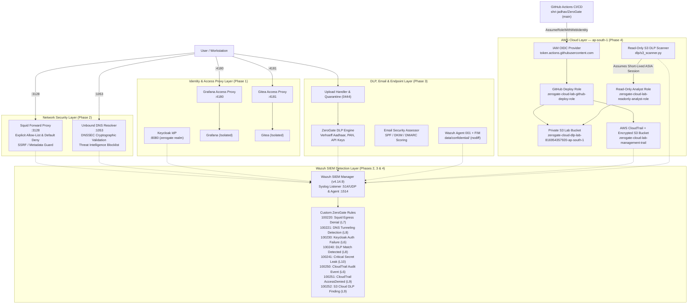

# ZeroGate Cloud — Zero Trust Security Platform (Phases 1–4)

ZeroGate Cloud is an end-to-end Zero Trust security platform combining local containerized micro-segmentation with AWS cloud audit and OIDC federation:
- **Phase 1 (Identity & Access Control)**: Centralized Keycloak OpenID Connect IdP with TOTP MFA, protected internal applications (Grafana, Gitea), dual `oauth2-proxy` identity-aware proxies, and strict Docker network isolation.
- **Phase 2 (Network Security & SIEM Detection)**: Controlled outbound forward proxy (Squid) with default deny and SSRF/cloud-metadata protection, validating recursive DNS resolver (Unbound) with DNSSEC and threat intelligence blocklists, and centralized log ingestion into Wazuh SIEM with custom detection rules (Squid egress denial & DNS tunneling detection).
- **Phase 3 (Endpoint Telemetry, Data Loss Prevention & Email Security)**: High-precision Python Data Loss Prevention (DLP) scanner (Verhoeff-validated synthetic Aadhaar, PAN format & entity status, API keys/cloud secrets), attack-resistant file upload processing and quarantine system, SPF/DKIM/DMARC DNS security assessor, Windows endpoint Sysmon configuration, Wazuh Agent File Integrity Monitoring (FIM) targeting confidential assets, and custom Wazuh detection rules (`100240`, `100241`).
- **Phase 4 (AWS Infrastructure, Terraform, OIDC, CI/CD Security Gates & Cloud Audit)**: Terraform-provisioned GitHub Actions IAM OIDC provider, separate least-privilege deployment and read-only analyst IAM roles, private encrypted S3 lab and CloudTrail buckets (`ap-south-1`), CloudTrail management trail with log file validation, $10/month AWS Budget guard, Policy-as-Code CI security gate rejecting 4 intentional insecure fixtures, read-only S3 DLP scanner, and Wazuh SIEM CloudTrail/S3 DLP detection rules (`100250`, `100251`, `100252`).

---

## 1. End-to-End Architecture Overview



---

## 2. Implemented Access Matrix (Application & Cloud IAM)

### 2.1 Internal Application RBAC Matrix
| Role | Synthetic User | Grafana (Port 4180) | Gitea (Port 4181) | Enforced Policy |
|---|---|---|---|---|
| **Employee** | `alice_emp` | **Allowed (200)** | **Denied (403)** | Blocked by Gitea proxy (`allowed_roles`) |
| **Analyst** | `bob_analyst` | **Allowed (200)** | **Allowed (200)** | Full access to both internal applications |
| **Admin** | `carol_admin` / `mfa_user` | **Allowed (200)** | **Allowed (200)** | Full administrator access across services |
| **Auditor** | `dave_auditor` | **Denied (403)** | **Allowed (200)** | Blocked from Grafana; Read-only mapped in Gitea |
| **No Role** | `eve_norole` | **Denied (403)** | **Denied (403)** | Blocked by both proxies with HTTP 403 Forbidden |

### 2.2 AWS Cloud Federated IAM Role Matrix (`ap-south-1`)
| IAM Role | Federation / Trust Condition | Permitted Scope | Explicitly Denied / Blocked |
|---|---|---|---|
| `zerogate-cloud-lab-github-deploy-role` | GitHub OIDC (`sts:AssumeRoleWithWebIdentity`)<br/>`aud == sts.amazonaws.com`<br/>`sub == repo:shri-jadhav/ZeroGate:ref:refs/heads/main` | Scoped `zerogate-cloud-*` S3 buckets, CloudTrail trail, monthly budget, and read-only IAM role checks (1h max session) | Wildcard `*` actions/resources, EC2/NAT/RDS creation, unrelated S3 buckets (`drainsentinel-*`), PR/fork workflows |
| `zerogate-cloud-lab-readonly-analyst-role` | Conditional Keycloak OIDC + Controlled Lab Principal with `sts:ExternalId == zerogate-analyst-session-v1` | Read-only S3 DLP scanning (`s3:GetObject`, `s3:ListBucket`) on `zerogate-cloud-dlp-lab-816954357920-ap-south-1` & CloudTrail status | `s3:DeleteObject`, `s3:PutObject`, `s3:PutBucketPolicy`, IAM changes, and unrelated S3 buckets (`AccessDenied` verified) |

---

## 3. Threat Model & Security Gaps

### Mitigated Threats
- **Unauthenticated Backend Bypass**: Mitigated by removing host port bindings on Grafana (`:3000`), Gitea (`:3000`), and Postgres (`:5432`) and isolating them on internal Docker bridge networks.
- **Open Redirect & Credential Stuffing**: Mitigated by pinning exact OIDC callback URIs (no `*` wildcards), enforcing 12-character complex passwords, 5-attempt brute-force lockout, and TOTP MFA.
- **SSRF & Cloud Metadata Theft**: Mitigated in Squid (`network/squid/squid.conf`) by explicitly blocking `169.254.169.254`, `127.0.0.0/8`, and RFC1918 subnets before domain allow-list evaluation.
- **DNS Spoofing & Data Exfiltration via DNS Tunneling**: Mitigated by Unbound DNSSEC validation (`auto-trust-anchor-file`) and Wazuh Rule `100221` alerting on encoded labels $\ge 25$ characters.
- **PII / Credential Leakage & Path Traversal on Upload**: Mitigated by Verhoeff Aadhaar checksums, PAN entity validation, path traversal stripping, `0o444` immutable quarantine, and `nodiff` FIM rules.
- **Long-Lived Cloud Credentials & Over-Privileged CI**: Mitigated by GitHub Actions OIDC (`AssumeRoleWithWebIdentity`), pinned subject claims, Policy-as-Code negative fixture gates, and CloudTrail digest verification.

### Known Security Gaps & Operational Limitations
1. **Localhost Keycloak to AWS IAM OIDC Limitation**: AWS IAM OIDC providers require a publicly reachable HTTPS endpoint with valid TLS certificates. Because local Keycloak runs on `http://localhost:8080` and must not expose admin interfaces publicly, direct Keycloak-to-AWS OIDC web-identity federation is gated behind `enable_keycloak_oidc = false`, while the analyst role's least-privilege permissions and short-lived STS session boundaries are verified via `AssumeRole` with `ExternalId`.
2. **Host Sysmon Windows Service**: `endpoint/sysmonconfig.xml` is validated against schema v4.90, but the live `Sysmon64` Windows driver/service is uninstalled on the host machine.
3. **Amazon GuardDuty Disabled**: The AWS account returned `SubscriptionRequiredException` for GuardDuty and enabling it incurs recurring costs after trial expiration; kept disabled (`enable_guardduty = false`) per budget safety rules.
4. **DLP Binary/OCR Scope**: The DLP engine scans UTF-8 text, CSV, JSON, and source code; scanned image PDFs require an upstream OCR pipeline.

---

## 4. Verification & Complete Automated Test Suite (83 Scenarios)

```powershell
# Set repository root in PYTHONPATH
$env:PYTHONPATH='C:\Users\Admin\Documents\ZeroGate'

# 1. Run the complete 83-test verification suite across Phases 1, 2, 3, and 4
.\.venv\Scripts\python.exe -m pytest -v tests/

# 2. Run Policy-as-Code & CI Security Gate Validator standalone
.\.venv\Scripts\python.exe -m policy.validator

# 3. Run Phase 4 Cloud Security, Negative Fixtures, S3 DLP & CloudTrail tests (12 scenarios)
.\.venv\Scripts\python.exe -m pytest -v tests/test_phase4_cloud_security.py

# 4. Run Standalone DLP Synthetic Benchmark (Precision & Recall Evaluation)
.\.venv\Scripts\python.exe dlp/evaluation.py
```

---

## 5. Safe AWS Teardown & Cost Precautions

```powershell
# 1. Inspect Terraform state and review destroy plan (confirm ONLY zerogate-cloud-* resources are listed)
C:\Tools\Terraform\terraform.exe -chdir="infra/terraform" state list
C:\Tools\Terraform\terraform.exe -chdir="infra/terraform" plan -destroy

# 2. When ready to tear down lab resources: stop CloudTrail and empty versioned objects in the 2 ZeroGate buckets
aws cloudtrail stop-logging --name zerogate-cloud-lab-management-trail --region ap-south-1
.\.venv\Scripts\python.exe -c "
import boto3
s3 = boto3.resource('s3', region_name='ap-south-1')
for b in ['zerogate-cloud-dlp-lab-816954357920-ap-south-1', 'zerogate-cloud-cloudtrail-816954357920-ap-south-1']:
    s3.Bucket(b).object_versions.delete()
"

# 3. Execute Terraform destroy
C:\Tools\Terraform\terraform.exe -chdir="infra/terraform" destroy
```

---

## 6. Comprehensive Status Table (Phases 1–4)

| Component / Requirement | Phase | Status | Verification Evidence |
|---|---|---|---|
| Keycloak Dedicated `zerogate` Realm & Brute Force Lockout | Phase 1 | **PASS** | Validated via `test_keycloak_realm_security_configuration` |
| Password Policy (12 chars, upper, lower, digit, special) | Phase 1 | **PASS** | Validated via realm export and `policy/validator.py` (`ZG-KC-003`) |
| OpenID Connect Exact Redirect URIs (No wildcards) | Phase 1 | **PASS** | Validated via `test_redirect_uris_contain_no_wildcards` |
| TOTP Multi-Factor Authentication Challenge & Enrollment | Phase 1 | **PASS** | Validated via `test_keycloak_mfa_enrollment_and_challenge_flow` with `pyotp` |
| Identity-Aware Proxies (`oauth2-proxy`) & Backend Port Isolation | Phase 1 | **PASS** | Validated on ports 4180/4181; ports 3000 & 5432 closed on host |
| Full 5-Role Access Matrix (Employee, Analyst, Admin, Auditor, NoRole) | Phase 1 | **PASS** | Validated end-to-end via `test_access_matrix_full_end_to_end_proxy_enforcement` |
| Squid Forward Proxy Allow-List, Port 443 & SSRF/Metadata Block | Phase 2 | **PASS** | Validated via 6 tests in `TestSquidForwardProxy` |
| Unbound DNSSEC Validation, Threat Blocklist & Default Refuse | Phase 2 | **PASS** | Validated via 5 tests in `TestUnboundDNSResolver` |
| Wazuh SIEM Ingestion & Rules 100220, 100221, 100230 | Phase 2 | **PASS** | Validated via 6 tests in `TestWazuhSIEMAndDetection` |
| DLP Verhoeff Aadhaar, PAN Entity Check, Secret Detection & Masking | Phase 3 | **PASS** | Validated via 17 tests in `test_dlp_scanner.py` |
| DLP Synthetic Benchmark (Precision >90%, Recall >85%) | Phase 3 | **PASS** | **100.00% Precision / 100.00% Recall** across 36 labeled samples |
| Safe Upload Path Traversal Prevention & Immutable Quarantine (`0o444`) | Phase 3 | **PASS** | Validated via 6 tests in `test_upload_quarantine.py` |
| Email SPF, DKIM & DMARC Checker (`p=none` as weak policy, not DNS error) | Phase 3 | **PASS** | Validated via 16 tests in `test_email_security.py` |
| Windows Sysmon v4.90 XML & Wazuh Agent FIM (`data/confidential` + `nodiff`) | Phase 3 | **PASS** | Validated via `test_phase3_endpoint_wazuh.py` |
| Wazuh DLP Detection Rules 100240 (L8) & 100241 (L10) | Phase 3 | **PASS** | Verified via `wazuh-logtest` and live `/var/ossec/logs/alerts/alerts.log` |
| Windows Host Sysmon Live Kernel Driver/Service | Phase 3 | **NOT TESTED** | XML schema validated; live Sysmon service uninstalled on Windows host |
| Terraform Formatting (`fmt -check`), Validation & Static Security | Phase 4 | **PASS** | Validated via `terraform validate` and `policy/validator.py` |
| Policy-as-Code Negative Test 1: Admin without MFA Rejected | Phase 4 | **PASS** | Validated via `test_negative_fixture_1_admin_without_mfa_rejected_and_production_passes` |
| Policy-as-Code Negative Test 2: Wildcard Redirect URI Rejected | Phase 4 | **PASS** | Validated via `test_negative_fixture_2_wildcard_redirect_uri_rejected_and_production_passes` |
| Policy-as-Code Negative Test 3: Broad IAM Trust Policy Rejected | Phase 4 | **PASS** | Validated via `test_negative_fixture_3_broad_iam_trust_policy_rejected_and_secure_passes` |
| Policy-as-Code Negative Test 4: Public S3 Bucket Policy Rejected | Phase 4 | **PASS** | Validated via `test_negative_fixture_4_public_s3_bucket_policy_rejected_and_secure_passes` |
| GitHub Actions OIDC Provider & Least-Privilege Deploy Role Deployed | Phase 4 | **PASS** | Deployed in `ap-south-1` & verified via `test_live_github_oidc_provider_and_deploy_role_trust_policy` |
| Live GitHub Actions Cloud Runner Execution | Phase 4 | **NOT TESTED** | Workflow validated locally; requires git push to GitHub remote to trigger cloud runner |
| Direct Keycloak (`localhost:8080`) to AWS IAM OIDC WebIdentity Call | Phase 4 | **BLOCKED** | AWS IAM OIDC requires public HTTPS endpoint; mitigated via controlled STS `AssumeRole` analyst verification |
| Separate Read-Only Analyst Role Short-Lived STS Assumption & S3 DLP Scan | Phase 4 | **PASS** | Verified live via `test_live_readonly_analyst_role_assumption_and_s3_dlp_scan` (`AccessDenied` on delete/unrelated buckets) |
| Private S3 Lab & CloudTrail Buckets (SSE-S3, Public Block, HTTPS-Only) | Phase 4 | **PASS** | Deployed in `ap-south-1` & verified via `test_live_s3_lab_bucket_encryption_and_public_access_block` |
| AWS CloudTrail Management Trail & Wazuh Rules 100250, 100251, 100252 | Phase 4 | **PASS** | Trail logging active in `ap-south-1`; rules verified in `wazuh-logtest` and live `alerts.log` |
| Amazon GuardDuty Detector | Phase 4 | **BLOCKED** | Account lacks GuardDuty subscription (`SubscriptionRequiredException`) & gated off (`enable_guardduty = false`) for cost safety |
| AWS Cost Budget (`$10.00/mo`) & Cost Explorer Verification | Phase 4 | **PASS** | Deployed `zerogate-cloud-lab-monthly-budget`; Cost Explorer MTD observed cost `$0.00 USD` |
