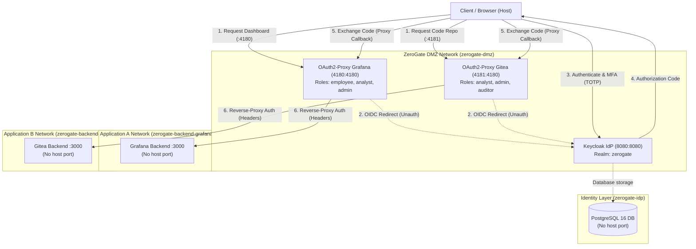

# ZeroGate Cloud — Phase 1 Architecture & Network Topology

## 1. Overview

ZeroGate Cloud Phase 1 establishes the foundational Zero Trust Access architecture for local service orchestration. The core paradigm replaces traditional perimeter network trust with identity-driven, role-authorized, proxy-mediated access.

Protected backend workloads (`Grafana` and `Gitea`) do **not** publish host ports. Direct network access from the host or unauthenticated entities is structurally blocked by Docker Compose network segregation. Access to any internal service requires OpenID Connect (OIDC) authentication against Keycloak and authorization claim verification via dedicated identity-aware proxies (`oauth2-proxy`).

---

## 2. Request Flow Lifecycle

1. **Initial Unauthenticated Request**:
   - The user navigates to `http://localhost:4180/` (Grafana) or `http://localhost:4181/` (Gitea).
   - The respective identity-aware proxy intercepts the request. In the absence of an authenticated session cookie (`_zg_grafana_oauth2` or `_zg_gitea_oauth2`), the proxy returns `HTTP 302 Found` redirecting the browser to Keycloak's OIDC Authorization endpoint with PKCE (`S256`) and an exact redirect URI.

2. **Authentication & Multi-Factor Challenge (Keycloak)**:
   - Keycloak presents the ZeroGate realm sign-in interface.
   - The user inputs credentials conforming to the password policy.
   - If MFA is enrolled or required, Keycloak challenges the user for their 6-digit Time-Based One-Time Password (TOTP).
   - Keycloak evaluates brute-force protection thresholds (max 5 failure attempts).

3. **Code Exchange & Token Claim Inspection**:
   - Upon successful 2FA, Keycloak issues an authorization code and redirects back to the exact client callback URI (`http://localhost:4180/oauth2/callback` or `http://localhost:4181/oauth2/callback`).
   - `oauth2-proxy` calls Keycloak's token endpoint over the internal Docker network (`http://keycloak:8080/realms/zerogate/protocol/openid-connect/token`) to exchange the code for signed ID and access tokens.
   - `oauth2-proxy` verifies token integrity, expiration, audience, and extracts the `roles` and `groups` claims.

4. **Authorization Enforcement**:
   - The proxy compares token claims against its configured `allowed_roles` rule set:
     - **Grafana Proxy**: requires `employee`, `analyst`, or `admin`. If the user has only `auditor` or no role, oauth2-proxy aborts and returns `HTTP 403 Forbidden`.
     - **Gitea Proxy**: requires `analyst`, `admin`, or `auditor`. If the user has only `employee` or no role, oauth2-proxy aborts and returns `HTTP 403 Forbidden`.

5. **Upstream Header Injection & Reverse Proxy Auth**:
   - If authorized, `oauth2-proxy` injects identity headers:
     - `X-Forwarded-Preferred-Username`
     - `X-Forwarded-Email`
     - `X-Forwarded-Groups` / `roles`
   - The backend service (`Grafana` or `Gitea`) reads the trusted proxy headers and authenticates the user into their profile without re-prompting for credentials.

---

## 3. Network Isolation Matrix

| Network | Type | Connected Services | Host Port Exposure |
|---|---|---|---|
| `zerogate-dmz` | Bridge | `keycloak`, `oauth2-proxy-grafana`, `oauth2-proxy-gitea` | Ports `8080`, `4180`, `4181` |
| `zerogate-idp` | Bridge (Internal) | `keycloak`, `postgres` | None (`5432` is private) |
| `zerogate-backend-grafana` | Bridge (Internal) | `oauth2-proxy-grafana`, `grafana` | None (`3000` is private) |
| `zerogate-backend-gitea` | Bridge (Internal) | `oauth2-proxy-gitea`, `gitea` | None (`3000` is private) |

---

## 4. End-to-End Platform Architecture (Phases 1–4)

- **Phase 1 (Identity & Access Control)**: Keycloak OIDC IdP (`zerogate` realm), TOTP MFA, 5-role RBAC matrix, dual `oauth2-proxy` instances, and isolated backend networks for Grafana and Gitea.
- **Phase 2 (Network Security & SIEM)**: Squid outbound forward proxy (explicit allow-list, SSRF/cloud-metadata block), Unbound validating DNSSEC resolver with threat-intelligence blocklists, and Wazuh SIEM rules `100220`–`100231`.
- **Phase 3 (DLP, Upload Quarantine, Email & Endpoint)**: Verhoeff-validated Aadhaar/PAN/Secret DLP scanner (100% precision/recall), traversal-safe upload quarantine (`0o444`), SPF/DKIM/DMARC DNS assessor, Sysmon v4.90 XML & Wazuh Agent FIM (`nodiff` on secrets), and Wazuh rules `100240`–`100241`.
- **Phase 4 (AWS Cloud, OIDC, Policy-as-Code & Cloud Audit)**: Terraform-managed GitHub Actions OIDC provider, least-privilege deployment & read-only analyst IAM roles, encrypted private S3 lab & CloudTrail buckets, single-region CloudTrail with digest validation, $10/month AWS Budget guard, Policy-as-Code CI validator with 4 negative fixture tests, read-only S3 DLP scanner, and Wazuh CloudTrail/S3 DLP rules `100250`–`100252`.

