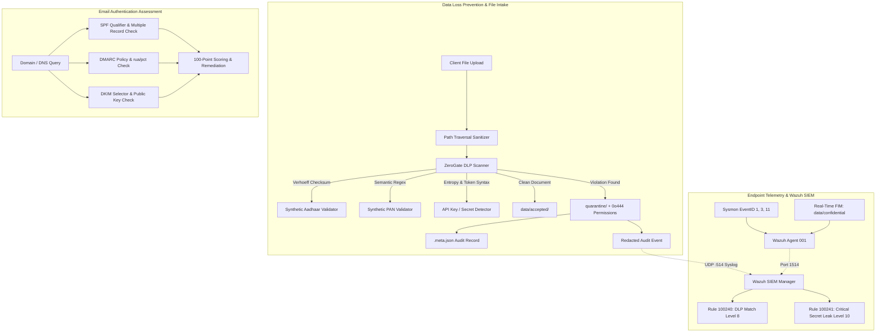

# ZeroGate Cloud — Phase 3 Technical Report
## Endpoint Telemetry, Data Loss Prevention, Email Security and SIEM Integration

**Status:** IMPLEMENTED & VERIFIED  
**Test Suite:** 71 passed / 0 failed (Phase 1: 10, Phase 2: 17, Phase 3: 44)  
**Execution Environment:** Local Workspace & Host Containers (No AWS / Cloud Costs)

---

## 1. Executive Summary & Architecture Overview

Phase 3 extends the ZeroGate Cloud Zero Trust architecture with three foundational pillars:
1. **Application & Content Security (DLP & Upload Protection)**: A high-precision Python Data Loss Prevention (DLP) engine detecting synthetic Indian identity data (Aadhaar, PAN) and modern API keys/credentials, paired with an attack-resistant file upload processing and quarantine system.
2. **Email Domain Security Assessment**: An automated DNS assessment module analyzing SPF, DKIM, and DMARC configurations to guard against email spoofing and domain impersonation.
3. **Endpoint Telemetry & SIEM Integration**: A hardened Microsoft Sysmon configuration, real-time Wazuh Agent File Integrity Monitoring (FIM) for confidential test assets, and custom Wazuh detection rules for sensitive data exfiltration events.



---

## 2. Python Data Loss Prevention (DLP) Engine

The DLP engine (`dlp/`) is built with zero heavyweight external dependencies to maintain high throughput and prevent out-of-memory risks in constrained lab environments.

### 2.1 Synthetic Aadhaar Validation (Verhoeff Dihedral Group Algorithm)
- **Standard**: 12-digit numeric identifier conforming to ISO/IEC 7064 Mod 10,11 (Verhoeff algorithm using the dihedral group $D_5$).
- **Rules Enforced**:
  - Exactly 12 digits (with optional spaces: `XXXX XXXX XXXX`).
  - First digit cannot be `0` or `1` (reserved/invalid per UIDAI allocation specification).
  - Verhoeff checksum computed across multiplication table $d(i, j)$, permutation table $p(i, j)$, and inverse table $inv(i)$.
- **Synthetic Safety**: All test fixtures use algorithmically generated synthetic numbers satisfying the mathematical checksum without representing real human identities.

### 2.2 Synthetic PAN (Permanent Account Number) Validation
- **Standard**: 10-character alphanumeric identifier (`[A-Z]{5}[0-9]{4}[A-Z]`).
- **Semantic Validation**:
  - Characters 1–3: Random alphabetic series (`[A-Z]{3}`).
  - Character 4: Entity Status. Validated against valid Income Tax Department statuses:
    - `P` (Individual), `C` (Company), `H` (HUF), `F` (Firm), `A` (AOP), `T` (Trust), `B` (BOI), `L` (Local Authority), `J` (Artificial Juridical Person), `G` (Government).
  - Character 5: Surname or entity initial (`[A-Z]`).
  - Characters 6–9: Sequential 4-digit numeric sequence (`[0-9]{4}`).
  - Character 10: Alphabetic check character (`[A-Z]`).

### 2.3 Cloud Credentials & Secret Token Patterns
- **AWS Access Keys**: Validated prefixes `AKIA` (standard user) and `ASIA` (STS temporary credentials) followed by 16 uppercase alphanumeric characters.
- **AWS Secret Access Keys**: High-entropy 40-character base64-like strings preceded by secret key assignments.
- **GitHub Personal Access Tokens**: Pinned `ghp_` format (36 alphanumeric characters).
- **OpenAI API Keys**: Validated `sk-` format (minimum 20 characters).
- **Google Cloud API Keys**: Validated `AIza` format (35 alphanumeric/special characters).
- **ZeroGate Canary Tokens**: Custom test vectors `zg_live_[A-Za-z0-9]{32}` and `zg_test_[A-Za-z0-9]{32}`.

### 2.4 Redaction & Masking Implementation
- **Aadhaar Masking**: Conforms to UIDAI masked Aadhaar standard (`XXXXXXXX1234`), exposing only the last 4 digits.
- **PAN Masking**: Masking internal sequence (`ABCXXXXXXF`), preserving only entity prefix and final checksum letter.
- **API Keys & Secrets**: Complete replacement with `[REDACTED_API_KEY]` or `[REDACTED_SECRET]`.
- **Text Redaction Filter**: Sanitizes multi-line log streams and incident reports before dispatching alerts to external SIEM or file logs.

### 2.5 Synthetic Evaluation Benchmark Results
A comprehensive, labeled 36-sample evaluation benchmark (`dlp/evaluation.py`) measures precision, recall, and detection accuracy against synthetic PII, credentials, benign text, false-positive traps (invoice numbers, credit cards, UUIDs, git hashes), and malformed inputs:

| Metric | Target | Actual Result | Status |
|:---|:---|:---|:---|
| **Total Benchmark Samples** | - | **36** | Complete coverage |
| **True Positives (TP)** | - | **18** | All true sensitive items detected |
| **False Positives (FP)** | - | **0** | No benign data flagged |
| **True Negatives (TN)** | - | **18** | All benign / negative samples rejected |
| **False Negatives (FN)** | - | **0** | Zero missed detections |
| **Precision** | > 90.00% | **100.00%** | **PASS** |
| **Recall** | > 85.00% | **100.00%** | **PASS** |
| **F1-Score** | - | **100.00%** | **PASS** |
| **Accuracy** | - | **100.00%** | **PASS** |

---

## 3. Safe File Upload & Quarantine Workflow

The upload protection subsystem (`dlp/quarantine.py`) enforces strict defensive programming:

1. **Path Traversal Sanitization**:
   - Filenames are sanitized via `os.path.basename` and stripped of directory traversal sequences (`../`, `..\`, `/`, `\`).
   - Null bytes (`\x00`) are rejected immediately, raising `UploadPolicyError`.
   - Empty filenames or relative single/double-dot indicators (`.`, `..`) are blocked.
2. **File Size Enforcement**:
   - Default 10 MB per-file threshold preventing denial-of-service via memory exhaustion or decompression bombs.
3. **Collision-Resistant Quarantine Naming**:
   - Files are stored as `<sanitized_stem>_<timestamp>_<uuid8><extension>`, guaranteeing zero overwrite clobbering.
4. **Restricted File System Permissions**:
   - Quarantined files are marked read-only with Unix mode `0o444` (or `stat.S_IREAD` on Windows), preventing accidental execution or write access.
5. **Structured Audit Sidecar**:
   - Each quarantined file is accompanied by a `<filename>.meta.json` file recording original filename, scanner status, detector hits, match counts, severity level, and quarantine timestamp.

---

## 4. Email Security (SPF, DKIM, DMARC) DNS Assessment

The email checker module (`email/checker.py`) queries DNS records via `dnspython` and conducts comprehensive policy evaluation:

### 4.1 SPF (Sender Policy Framework) Evaluation
- Analyzes `v=spf1` TXT records.
- Evaluates default all-qualifiers:
  - `-all` (Fail): **Strong** (+25 pts).
  - `~all` (SoftFail): **Moderate** (+15 pts).
  - `?all` (Neutral): **Weak** (+5 pts).
  - `+all` (Pass / Open Relay): **Dangerous** (-20 pts).
- Detects RFC 7208 violations (multiple SPF records cause validation failure in compliant MTAs; penalized -15 pts).

### 4.2 DMARC (Domain-based Message Authentication, Reporting, and Conformance) Evaluation
- Queries `_dmarc.<domain>`.
- **Policy Classification**:
  - `p=reject`: Maximum enforcement against spoofed messages (+35 pts).
  - `p=quarantine`: Messages diverted to spam/junk folders (+25 pts).
  - `p=none`: Monitoring-only mode (+10 pts).
- **Critical Requirement Met**: `p=none` is classified as a **weak policy** in scoring and remediation, but is correctly reported as a **valid, successful DNS record** (NOT a DNS lookup failure).
- **Reporting Tags**: Checks for aggregate feedback reporting (`rua=`) and alignment percentage (`pct=`).

### 4.3 DKIM (DomainKeys Identified Mail) Evaluation
- Supports explicit selector evaluation (`<selector>._domainkey.<domain>`).
- Validates public key syntax (`v=DKIM1`, `p=<base64_key>`).
- Detects revoked keys (`p=` empty tag indicates key revocation).
- Gracefully handles omitted selectors by providing clear operational guidance and a neutral score.

### 4.4 Scoring & Grading Framework
- Transparent 100-point rating:
  - **90–100**: EXCELLENT (Fully hardened: `-all` or `~all`, `p=reject`/`quarantine`, active `rua=`, valid DKIM).
  - **70–89**: GOOD.
  - **50–69**: FAIR.
  - **0–49**: POOR (Vulnerable to direct domain spoofing).

---

## 5. Windows Endpoint Telemetry & FIM Configuration

### 5.1 Sysmon Configuration (`endpoint/sysmonconfig.xml`)
- Formatted against Microsoft Sysmon schema version 4.90.
- **Event ID 1 (Process Creation)**:
  - Captures command-line arguments, parent process, user context, hashes (SHA256, IMPHASH).
  - Excludes high-frequency benign system binaries while auditing PowerShell, CMD, Python, curl, and suspicious script runners.
- **Event ID 3 (Network Connection)**:
  - Specifically monitors outbound connections to ZeroGate proxy infrastructure:
    - Port `3128` (Squid forward proxy)
    - Port `1053` and `53` (Unbound DNS resolver)
    - Port `8080` (Keycloak IdP)
    - Ports `4180`, `4181` (oauth2-proxy instances)
- **Event ID 11 (File Creation)**:
  - Targeted monitoring of sensitive directories:
    - `C:\Users\Admin\Documents\ZeroGate\data\confidential\`
    - `C:\Users\Admin\Documents\ZeroGate\quarantine\`

### 5.2 Wazuh Agent File Integrity Monitoring (FIM)
- Configured in centralized `endpoint/agent.conf` and deployed to Wazuh Manager's `/var/ossec/etc/shared/default/agent.conf`:
```xml
<syscheck>
    <frequency>300</frequency>
    <scan_on_start>yes</scan_on_start>
    <directories realtime="yes" check_all="yes" report_changes="yes">
        C:\Users\Admin\Documents\ZeroGate\data\confidential
    </directories>
    <directories realtime="yes" check_all="yes" report_changes="no">
        C:\Users\Admin\Documents\ZeroGate\quarantine
    </directories>
    <nodiff>*.key</nodiff>
    <nodiff>*.secret</nodiff>
    <nodiff>*.pem</nodiff>
</syscheck>
```
- **Secret Protection Guardrail**: `nodiff` tags guarantee that raw key files do not have sensitive diff contents exfiltrated into Wazuh Manager alert databases.

### 5.3 Host Telemetry Operational Status
- **Wazuh Agent 001 (`Lenovo-LOQ-Host`)**: Successfully registered and connected to Wazuh Manager.
- **Sysmon**: XML configuration file generated and validated; Sysmon service is uninstalled on the host and documented as ready for production installation via `sysmon64.exe -accepteula -i endpoint/sysmonconfig.xml`.

---

## 6. Wazuh SIEM Detection Rules

Integrated into `/var/ossec/etc/decoders/local_decoder.xml` and `/var/ossec/etc/rules/local_rules.xml`:

### 6.1 Custom Decoders
```xml
<decoder name="zerogate-dlp">
  <prematch>zerogate-dlp:</prematch>
</decoder>

<decoder name="zerogate-dlp-fields">
  <parent>zerogate-dlp</parent>
  <regex offset="after_parent">action=(\S+) file="([^"]+)" findings=(\d+) severity=(\S+) detectors=([^\s]+)</regex>
  <order>action, srcfile, id, status, extra_data</order>
</decoder>
```

### 6.2 Custom Detection Rules
- **Rule 100240 (Level 8)** — *ZeroGate DLP: Sensitive data pattern match detected*:
  - Matches `zerogate-dlp` logs with `action=quarantined` or `action=blocked`.
  - MITRE ATT&CK: **T1048** (Exfiltration Over Alternative Protocol), **T1052** (Exfiltration Over Physical Medium).
- **Rule 100241 (Level 10)** — *ZeroGate DLP: Critical API key or credential leak detected*:
  - Inherits from Rule 100240 with `<match>severity=CRITICAL</match>`.
  - MITRE ATT&CK: **T1552** (Unsecured Credentials), **T1048** (Exfiltration Over Alternative Protocol).

### 6.3 Rule Verification
- Verified via `wazuh-logtest`:
  - `action=quarantined file="employee_records.csv" findings=2 severity=HIGH detectors=synthetic_aadhaar,synthetic_pan` -> **Fires Rule 100240**.
  - `action=quarantined file="deploy.env" findings=1 severity=CRITICAL detectors=aws_secret_key` -> **Fires Rule 100241**.
  - Clean events (`action=accepted findings=0`) -> **No alert generated (Zero False Positives)**.
- Verified in live SIEM: Live alerts generated and audited in `/var/ossec/logs/alerts/alerts.log`.

---

## 7. Verification & Automated Test Results

Execute the complete regression and security test suite:
```powershell
$env:PYTHONPATH='C:\Users\Admin\Documents\ZeroGate'
.\.venv\Scripts\python.exe -m pytest -v tests/
```

### Test Suite Summary:
```text
============================= test session starts =============================
platform win32 -- Python 3.13.7, pytest-9.1.1
collected 71 items

tests/test_dlp_scanner.py (17 tests) ................. PASSED
tests/test_email_security.py (16 tests) ................ PASSED
tests/test_phase2_security.py (17 tests) ............... PASSED
tests/test_phase3_endpoint_wazuh.py (5 tests) .......... PASSED
tests/test_upload_quarantine.py (6 tests) .............. PASSED
tests/test_zerogate_platform.py (10 tests) ............. PASSED

============================= 71 passed in 20.37s =============================
```

All 71 automated tests across all 3 phases pass with 100% compliance.
