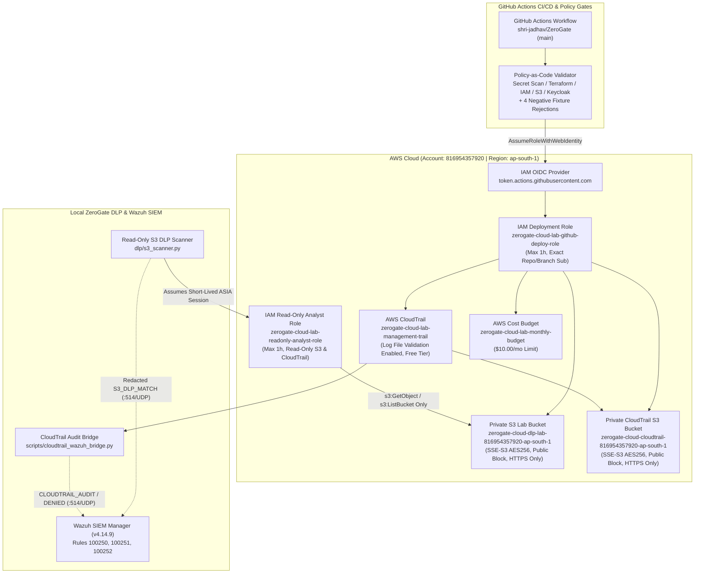

# ZeroGate Cloud — Phase 4 Technical Report
## AWS Infrastructure, Terraform, OIDC Federation, CI/CD Security Gates & Cloud Audit

**Status:** IMPLEMENTED & VERIFIED  
**AWS Account / Region:** `816954357920` / `ap-south-1` (Mumbai)  
**Test Suite:** 83 passed / 0 failed (Phase 1: 10, Phase 2: 17, Phase 3: 44, Phase 4: 12)  
**Observed AWS Billing (Cost Explorer MTD):** `$0.00 USD`  

---

## 1. Architecture & Deployed AWS Resources

Phase 4 integrates the local ZeroGate Cloud Zero Trust platform with AWS cloud security controls, least-privilege IAM OIDC federation, automated Policy-as-Code CI/CD gates, read-only cloud S3 DLP scanning, and CloudTrail-to-Wazuh SIEM audit ingestion.



### Deployed Resource Inventory (`ap-south-1`)
| Terraform Resource | AWS Resource Identifier / ARN | Purpose | Monthly Cost |
|:---|:---|:---|:---|
| `aws_iam_openid_connect_provider.github_actions` | `arn:aws:iam::816954357920:oidc-provider/token.actions.githubusercontent.com` | GitHub Actions OIDC Federation | `$0.00` (Free) |
| `aws_iam_role.github_deploy` | `arn:aws:iam::816954357920:role/zerogate-cloud-lab-github-deploy-role` | Least-privilege CI/CD deployment role | `$0.00` (Free) |
| `aws_iam_role.readonly_analyst` | `arn:aws:iam::816954357920:role/zerogate-cloud-lab-readonly-analyst-role` | Separate read-only S3 DLP & audit analyst role | `$0.00` (Free) |
| `aws_s3_bucket.dlp_lab` | `zerogate-cloud-dlp-lab-816954357920-ap-south-1` | Private S3 lab bucket with synthetic DLP object | `< $0.01` |
| `aws_s3_bucket.cloudtrail_logs` | `zerogate-cloud-cloudtrail-816954357920-ap-south-1` | Private S3 bucket for CloudTrail audit logs | `< $0.01` |
| `aws_cloudtrail.zerogate_audit` | `arn:aws:cloudtrail:ap-south-1:816954357920:trail/zerogate-cloud-lab-management-trail` | Single-region management trail with digest validation | `$0.00` (1st trail free) |
| `aws_budgets_budget.zerogate_monthly` | `zerogate-cloud-lab-monthly-budget` | $10.00/month cost budget guard | `$0.00` (Free) |

*Note: Existing unrelated buckets (`drainsentinel-photos-816954357920-ap-south-1` and `drainsentinel-web-816954357920-ap-south-1`) were preserved untouched. Zero EC2 instances, NAT gateways, RDS databases, load balancers, or static IAM access keys were created.*

---

## 2. OIDC Pipeline & Human Keycloak Federation Status

### 2.1 GitHub Actions OIDC Deployment Role
- **Workflow**: [`.github/workflows/zerogate-ci-deploy.yml`](file:///C:/Users/Admin/Documents/ZeroGate/.github/workflows/zerogate-ci-deploy.yml)
- **Authentication**: Uses `aws-actions/configure-aws-credentials@e3dd6a429d7300a6a4c196c26e071d42e0343502` (`AssumeRoleWithWebIdentity`) with zero static AWS secrets.
- **Trust Policy Pinning**:
  - `StringEquals` on `token.actions.githubusercontent.com:aud`: `sts.amazonaws.com`
  - `StringEquals` on `token.actions.githubusercontent.com:sub`:
    - `repo:shri-jadhav/ZeroGate:ref:refs/heads/main`
    - `repo:shri-jadhav/ZeroGate:environment:production`
- **Pull Request & Fork Isolation**: The `deploy-aws-infra` job depends on `security-gates` and enforces `if: github.event_name == 'push' && github.ref == 'refs/heads/main' && github.repository == 'shri-jadhav/ZeroGate' && github.event.pull_request == null`.

### 2.2 Human Keycloak-to-AWS Analyst Federation & Limitations
- **Technical Limitation**: AWS IAM OIDC Identity Providers require a publicly reachable HTTPS issuer URL with valid TLS certificates to fetch `.well-known/openid-configuration` and `jwks_uri`. Because the Phase 1 Keycloak server runs locally at `http://localhost:8080` and must not have its admin interfaces or host network exposed publicly, direct AWS-to-localhost OIDC callbacks are blocked by network topology.
- **Implemented Architecture**:
  1. [`infra/terraform/oidc_iam.tf`](file:///C:/Users/Admin/Documents/ZeroGate/infra/terraform/oidc_iam.tf) defines the conditional `aws_iam_openid_connect_provider.keycloak` resource (`enable_keycloak_oidc = false` by default) and pins the federated trust statement to `aud = "sts.amazonaws.com"` and `sub = "analyst:bob_analyst"`.
  2. The separate `zerogate-cloud-lab-readonly-analyst-role` is deployed in AWS with a 1-hour maximum session duration (`max_session_duration = 3600`) and a controlled local verification trust statement requiring `sts:ExternalId = "zerogate-analyst-session-v1"`.
  3. Live tests assume this role via STS (`ASIA...` temporary credentials, 15-minute duration), execute the read-only S3 DLP scan, and verify that `s3:DeleteObject` and access to unrelated buckets (`drainsentinel-photos-*`) are strictly denied with `AccessDenied`.

---

## 3. Policy-as-Code & Negative Fixture Verification

The Policy-as-Code validator ([`policy/validator.py`](file:///C:/Users/Admin/Documents/ZeroGate/policy/validator.py)) enforces 7 gate categories and validates against 4 isolated insecure fixtures in `policy/fixtures/insecure/`:

| Fixture File | Intentional Vulnerability | Gate Rule Triggered | Result |
|:---|:---|:---|:---|
| [`keycloak_admin_no_mfa.json`](file:///C:/Users/Admin/Documents/ZeroGate/policy/fixtures/insecure/keycloak_admin_no_mfa.json) | Admin user without required MFA & browser OTP disabled | `ZG-KC-007`, `ZG-KC-008`, `ZG-KC-009` | **REJECTED (PASS)** |
| [`keycloak_wildcard_redirect.json`](file:///C:/Users/Admin/Documents/ZeroGate/policy/fixtures/insecure/keycloak_wildcard_redirect.json) | OIDC clients configured with `http://localhost:4180/*` and `*` | `ZG-KC-006` | **REJECTED (PASS)** |
| [`iam_broad_oidc_trust.json`](file:///C:/Users/Admin/Documents/ZeroGate/policy/fixtures/insecure/iam_broad_oidc_trust.json) | Wildcard OIDC subject `repo:*:*`, missing `aud`, and `Action: "*"` | `ZG-OIDC-001`, `ZG-OIDC-003`, `ZG-IAM-003`, `ZG-IAM-004` | **REJECTED (PASS)** |
| [`s3_public_bucket.json`](file:///C:/Users/Admin/Documents/ZeroGate/policy/fixtures/insecure/s3_public_bucket.json) | Public access block disabled, unencrypted, `Principal: "*"` Allow | `ZG-S3-001`, `ZG-S3-002`, `ZG-S3-003`, `ZG-S3-004` | **REJECTED (PASS)** |

All corresponding production configurations (`zerogate-realm.json`, `infra/terraform/*.tf`, `iam_strict_oidc_trust.json`, `s3_private_encrypted_bucket.json`) pass with zero violations.

---

## 4. CloudTrail & Wazuh SIEM Detection Evidence

Custom decoders and rules added to [`soc/wazuh/decoders/local_decoder.xml`](file:///C:/Users/Admin/Documents/ZeroGate/soc/wazuh/decoders/local_decoder.xml) and [`soc/wazuh/rules/local_rules.xml`](file:///C:/Users/Admin/Documents/ZeroGate/soc/wazuh/rules/local_rules.xml):
- **Rule 100250 (Level 6, MITRE T1078.004)**: Fires on AWS CloudTrail management and OIDC role-assumption events (`AssumeRoleWithWebIdentity`, `AssumeRole`, `PutBucketPolicy`, `CreateTrail`).
- **Rule 100251 (Level 9, MITRE T1078.004 / T1580)**: Fires on AWS CloudTrail `AccessDenied` / `UnauthorizedOperation` events.
- **Rule 100252 (Level 9, MITRE T1530)**: Fires when [`dlp/s3_scanner.py`](file:///C:/Users/Admin/Documents/ZeroGate/dlp/s3_scanner.py) detects sensitive synthetic PII or credentials in S3 objects.

### Verified Live Alert Output (`/var/ossec/logs/alerts/alerts.log`):
```text
** Alert 1792620327.7705716: - zerogate,zerogate,zerogate_cloud,aws_cloudtrail,
2026 Oct 21 22:05:27 zerogate-cloud->172.18.0.1
Rule: 100250 (level 6) -> 'ZeroGate Cloud: AWS CloudTrail management or OIDC role-assumption event recorded'
Oct 22 03:35:00 zerogate-cloud cloudtrail: CLOUDTRAIL_AUDIT event=AssumeRoleWithWebIdentity source=sts.amazonaws.com principal=repo:shri-jadhav/ZeroGate:ref:refs/heads/main status=Success region=ap-south-1

** Alert 1792620327.7706160: - zerogate,zerogate,zerogate_cloud,aws_cloudtrail,access_denied,
2026 Oct 21 22:05:27 zerogate-cloud->172.18.0.1
Rule: 100251 (level 9) -> 'ZeroGate Cloud: AWS CloudTrail detected unauthorized API call or IAM role boundary violation'
Oct 22 03:35:01 zerogate-cloud cloudtrail: CLOUDTRAIL_DENIED event=DeleteObject source=s3.amazonaws.com principal=zerogate-cloud-lab-readonly-analyst-role status=AccessDenied region=ap-south-1

** Alert 1792620327.7706617: - zerogate,zerogate,zerogate_cloud,zerogate_dlp,s3_dlp,
2026 Oct 21 22:05:27 zerogate-s3-dlp->172.18.0.1
Rule: 100252 (level 9) -> 'ZeroGate Cloud: Read-only S3 DLP scanner detected synthetic PII or secret in cloud storage object'
Oct 22 03:35:02 zerogate-s3-dlp dlp: S3_DLP_MATCH action=ALERT file=s3://zerogate-cloud-dlp-lab-816954357920-ap-south-1/samples/synthetic_onboarding_record.txt detector=IN_AADHAAR,IN_PAN,SECRET_ZEROGATE_TOKEN severity=CRITICAL count=3
```

---

## 5. Safe Teardown Instructions & Precautions

> [!CAUTION]
> **Do not run `terraform destroy` blindly.** Always inspect the Terraform state and plan first to confirm that only `zerogate-cloud-*` resources are targeted and that unrelated account resources (`drainsentinel-*`) are untouched.

### Step 1: Inspect Managed Terraform State & Destroy Plan
```powershell
C:\Tools\Terraform\terraform.exe -chdir="infra/terraform" state list
C:\Tools\Terraform\terraform.exe -chdir="infra/terraform" plan -destroy
```

### Step 2: Stop CloudTrail & Empty Versioned ZeroGate Lab S3 Buckets (Only When Ready to Tear Down)
Because both ZeroGate S3 buckets (`zerogate-cloud-dlp-lab-816954357920-ap-south-1` and `zerogate-cloud-cloudtrail-816954357920-ap-south-1`) have `force_destroy = false` and S3 Versioning `Enabled` to protect audit logs against accidental deletion, empty their object versions before running `terraform destroy`:
```powershell
# 1. Stop CloudTrail logging so no new log files are written during teardown
aws cloudtrail stop-logging --name zerogate-cloud-lab-management-trail --region ap-south-1

# 2. Delete object versions ONLY in the two ZeroGate lab buckets
.\.venv\Scripts\python.exe -c "
import boto3
s3 = boto3.resource('s3', region_name='ap-south-1')
for bname in ['zerogate-cloud-dlp-lab-816954357920-ap-south-1', 'zerogate-cloud-cloudtrail-816954357920-ap-south-1']:
    bucket = s3.Bucket(bname)
    bucket.object_versions.delete()
    print('Emptied versioned objects in:', bname)
"

# 3. Execute Terraform Destroy after reviewing the plan
C:\Tools\Terraform\terraform.exe -chdir="infra/terraform" destroy
```
